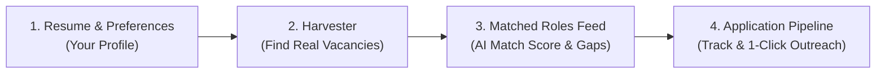

# 🧭 JobHunt AI — Complete Beginner's Walkthrough & User Guide

Welcome to your personal AI job search copilot. This guide explains **what each section does**, **why it is there**, and **how to use the platform step-by-step** to find vacancies and land interviews.

---

## 🎯 The Core Concept: How This Platform Works

Think of this platform as your private command center for job hunting. Instead of manually opening 10 browser tabs across LinkedIn, Naukri, and company career pages every day, this tool does the heavy lifting in 4 connected steps:

---

## 🧭 What Does Each Section Mean?

### 1. 💼 Matched Roles (Feed)
* **What it is:** Your daily inbox of matching vacancies.
* **Why it exists:** When jobs are scraped or added, they appear here formatted with:
  * Company name & exact location (e.g., *Pune*, *Mumbai*, *Hyderabad*).
  * Compensation in **₹ LPA** (e.g., *₹10 – ₹16 LPA*).
  * **Freshness Badge**: Tells you if a job was posted **within 48 hours** or older.
  * **AI Match Score**: Tells you if you are a **90%+ Strong Fit** or **75% Good Match** based on your uploaded resume.
* **What you do here:** Filter jobs by *Last 48 Hours*, *Role*, *Technology*, or *City*, review the match reason, and click **"Apply"** or **"AI Review"**.

---

### 2. 📋 Pipeline (Kanban Board)
* **What it is:** Your visual progress tracker for applications.
* **Why it exists:** When you apply to 15–20 companies, it is easy to forget who you applied to, when you applied, and who scheduled an interview.
* **The 6 Stages:**
  1. **Discovered**: New jobs you found that look interesting.
  2. **Saved / Reviewing**: Jobs you plan to apply for today.
  3. **Applied**: Jobs where you submitted your application (record date applied).
  4. **Interviewing**: Companies that called you for HR screening or technical rounds.
  5. **Offer Received**: Companies that gave you an offer letter!
  6. **Archived / Rejected**: Jobs you decided to skip or got closed.
* **What you do here:** Click the **`>`** arrow on any card to move it forward as you progress through interviews.

---

### 3. 🔍 Harvester (Job Finder Engine)
* **What it is:** The search engine that pulls real jobs into your platform.
* **Why it exists:** To collect vacancies from different sources into one clean place.
* **The 4 Tools inside Harvester:**
  1. **Direct ATS (Free, Zero Cost)**: 
     * *How to use*: Pick a company preset (*Razorpay*, *CRED*, *Swiggy*, *BrowserStack*, *Atlassian India*) or type any company name, and click **Fetch Active Roles**. It hits their public career portal directly!
  2. **Apify (Job Boards)**: 
     * *How to use*: Choose *LinkedIn Jobs* or *Google Jobs*, enter your city (*Pune* or *Mumbai*), enter your role (*Software Developer* or *React*), and click search.
  3. **Firecrawl (Link Scraper)**: 
     * *How to use*: Found a job link on WhatsApp, LinkedIn, or Naukri? Paste the link here, and Firecrawl scrapes the requirements cleanly into your dashboard.
  4. **Manual Drop**: 
     * *How to use*: Quickly paste a job title, company name, and description if you just want to track a job manually.

---

### 4. 👤 Resume & Preferences (Your Profile)
* **What it is:** Your master profile that powers all AI evaluations.
* **Why it exists:** The AI cannot score jobs or write customized recruiter notes without knowing your background.
* **What you do here:**
  * **Upload Resume**: Drop your PDF resume here. Gemini automatically extracts your experience, skills, and contact info.
  * **Indian Hiring Filters**: Select your cities (*Pune*, *Mumbai*, *Hyderabad*), notice period (*Immediate*, *30 Days*), and current/expected CTC.

---

### 5. ⚙️ Settings (API Keys & Storage Mode)
* **What it is:** Where you plug in your API keys and monitor your cloud database.
* **Google Gemini API Key**: [Get free key here](https://aistudio.google.com/app/apikey). Used for parsing resumes, calculating match scores, and writing recruiter outreach notes.
* **Cloudflare D1 / Supabase**: Serverless cloud databases that keep your data synced across mobile and laptop 24/7.
* **Apify / Firecrawl Keys**: Optional keys for automated web scraping.

---

## 🚀 Step-by-Step: How to Use the App Every Day

### Step 1: Complete Setup (1 Minute)
1. Open [http://localhost:3000](http://localhost:3000).
2. If the setup popup appears (or click **"Edit Preferences & Resume"** on the feed):
   * Upload your Resume PDF.
   * Pick your roles (*e.g., Software Developer, React Developer, Fullstack*).
   * Pick your technologies (*e.g., React, Java, Python, C#*).
   * Pick your locations (*e.g., Pune, Mumbai, Hyderabad*).
   * Click **Show Real Vacancies (Last 48 Hours)**.

### Step 2: Discover Jobs (2 Minutes)
1. Go to the **Harvester** tab.
2. Under **Direct ATS**, click on **Razorpay**, **BrowserStack**, or **Swiggy** and click **Fetch Active Roles**.
3. Under **Apify**, select *Google Jobs* or *LinkedIn*, type `Software Developer Pune`, and click **Search**.
4. The newly found roles are automatically imported into your feed!

### Step 3: Review Matched Roles (Feed)
1. Switch to the **Matched Roles** tab.
2. Look at the **⚡ Last 48 Hours** tab (active by default).
3. Find jobs with **90%+ Strong Fit** or **75%+ Good Match**.
4. Read the 1-line **"Why it matches"** summary.

### Step 4: Inspect Fit & Get Interview Talking Points
1. Click **"AI Review"** on any job card.
2. Read:
   * **Key Strengths**: Why your resume passes the filter.
   * **Skill Gaps**: Questions the interviewer might ask you.
   * **Interview Talking Points**: Technical stories from your resume to highlight.

### Step 5: Send 1-Click Recruiter Outreach & Apply
1. Inside the job modal, click **"Recruiter Outreach & Pitches"**.
2. Click **Generate with Gemini** ➔ choose **LinkedIn Recruiter Note** or **Cold Email**.
3. Click **Copy**.
4. Click **Apply Link** ➔ submit your application on the company's portal or message the recruiter on LinkedIn using your copied pitch!
5. In your platform, change the status to **Applied**!

---

## 💡 Quick Reference Summary

| Goal | Where to Go |
| :--- | :--- |
| **I want to see vacancies added today/yesterday** | Go to **Matched Roles** ➔ Look at **⚡ Last 48 Hours** |
| **I want to pull new jobs from LinkedIn or Google** | Go to **Harvester** ➔ Click **Apify** or **Direct ATS** |
| **I want to track who I have applied to** | Go to **Pipeline** (Kanban Board) |
| **I want to upload an updated resume or change my city** | Go to **Resume & Preferences** |
| **I want to write a tailored message to a recruiter** | Click **AI Review** on any job ➔ **Recruiter Outreach** |
| **I want to access from mobile & laptop 24/7** | Set up **Cloudflare D1** & deploy to Vercel (see below) |

---

## 📱 24/7 Mobile & Laptop Access (Cloudflare D1 Setup)

To access JobHuntAI on your mobile phone and laptop without keeping your computer turned on, you can host it for free on **Vercel** with **Cloudflare D1** as the serverless cloud database:

### Step 1: Create a Free Cloudflare D1 Database (2 Minutes)
1. Log in to [dash.cloudflare.com](https://dash.cloudflare.com) (free account).
2. In the left sidebar, click **Workers & Pages** ➔ **D1 SQL Database**.
3. Click **Create database** ➔ Name it `jobhuntai-db`.
4. Click into `jobhuntai-db`, click the **Console** tab.
5. Copy the contents of [`cloudflare_d1_schema.sql`](file:///c:/Users/ishaw/Documents/antigravity/goofy-pasteur/cloudflare_d1_schema.sql) from this repository, paste it into the console, and click **Execute**.

### Step 2: Get Your 3 Cloudflare Credentials
* **Account ID**: Click your account name at the top or find your Account ID on the right sidebar of the Cloudflare Dashboard.
* **Database ID**: Visible under the database name on your D1 database page (looks like `xxxxxxxx-xxxx-xxxx-xxxx-xxxxxxxxxxxx`).
* **API Token**: Go to [dash.cloudflare.com/profile/api-tokens](https://dash.cloudflare.com/profile/api-tokens) ➔ **Create Token** ➔ Select the template **Create Additional Tokens** or **Edit Cloudflare Workers** (with D1 edit permission) ➔ Copy the token.

### Step 3: Deploy to Vercel for Free (1 Minute)
1. Go to [vercel.com](https://vercel.com) and click **"Add New Project"**.
2. Select your GitHub repository: `https://github.com/RushabhDabre/jobhuntai.git`.
3. Under **Environment Variables**, paste:
   * `GEMINI_API_KEY` = *(your Gemini key)*
   * `CLOUDFLARE_ACCOUNT_ID` = *(from step 2)*
   * `CLOUDFLARE_D1_DATABASE_ID` = *(from step 2)*
   * `CLOUDFLARE_API_TOKEN` = *(from step 2)*
4. Click **Deploy**.

🎉 You get a custom URL like `https://jobhuntai.vercel.app` that you can open on your iPhone or Android browser, bookmark to your home screen, and access from your laptop 24/7!
